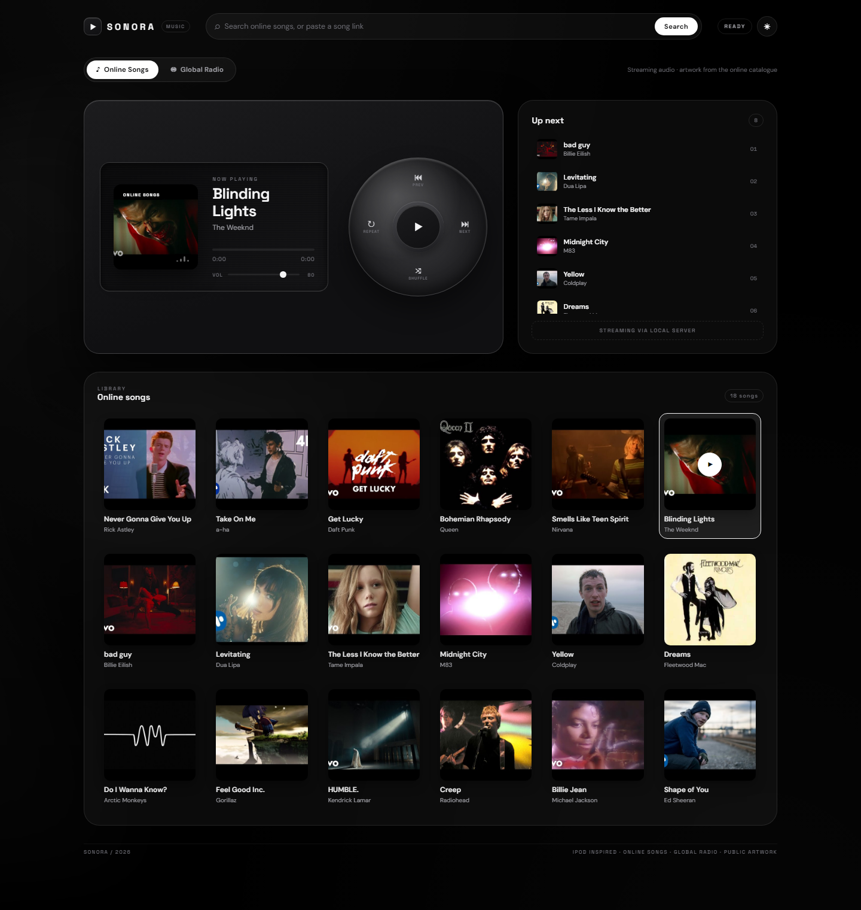
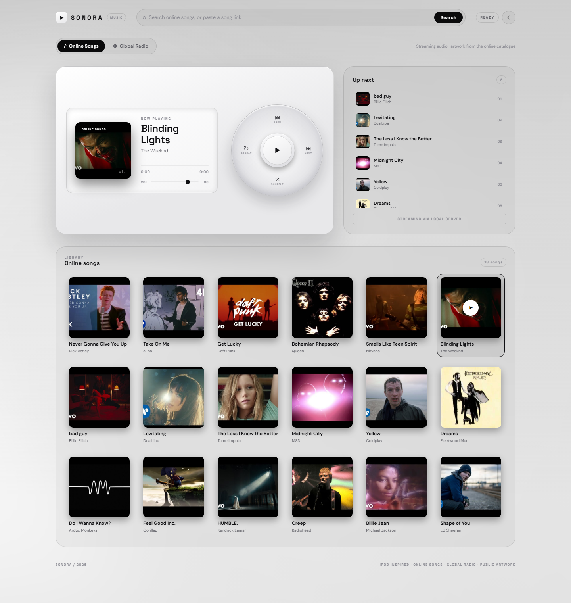
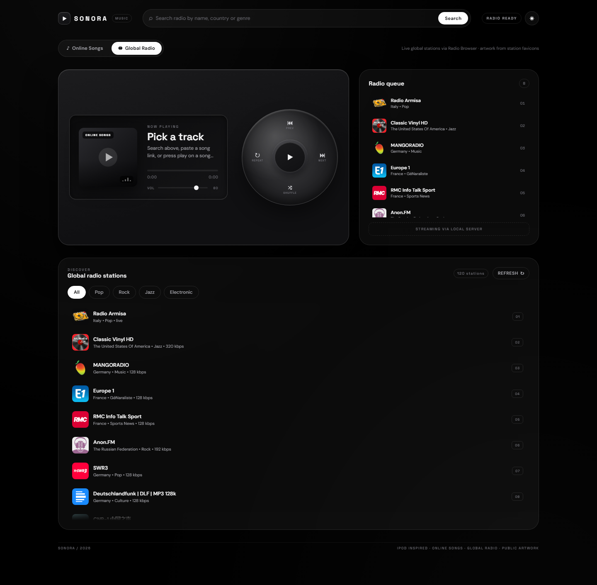

<div align="center">

# ◉ S O N O R A

**An iPod-inspired music player for the browser.**
Online songs, live global radio, public artwork, and a click wheel that feels right.

<sub>Built by <b>Starly Industries</b> · black &amp; white iPod themes</sub>

<br />



<br /><br />


</div>

---

## ✦ Two modes, one device

| **Online Songs** | **Global Radio** |
| :-- | :-- |
| Search the catalogue, stream full tracks, browse artwork. | 120 live stations from the global directory, filtered by genre. |
| Continuous playback with the next track preloaded. | Instant tuning, LIVE badge, animated signal bar. |
| Paste any song link or video ID to play it. | Dead streams are dimmed and skipped. |

<div align="center">
  
  
</div>

---

## ✦ What's inside

- **Click wheel** — prev / next / shuffle / repeat around a single centre play button.
- **Queue** — always shows what plays next; click any row to jump forward.
- **Seek &amp; volume** — drag the bar, use arrow keys on it, or scroll the volume slider.
- **Instant hand-off** — two audio elements alternate, so the next track is buffered before it starts.
- **Public artwork** — covers come from the catalogue CDN, with generated art as a fallback.
- **Two themes** — authentic iPod black and white; every control stays visible in both.
- **Responsive** — the layout, type and controls scale; nothing is hidden on small screens.
- **Keyboard first** — `Space`, `←` `→`, `S`, `R`, `T`, `/`.
- **Remembers you** — theme, volume, shuffle, repeat, last mode and last track.

---

## ✦ Quick start

```bash
pip install -r requirements.txt
python server.py
```

Then open **http://127.0.0.1:8787**

The Python server is what makes Online Songs work: it serves the page, searches the
catalogue, resolves audio and serves a small JSON API. Opening `index.html` directly
still shows the interface and Radio, and the page tells you when the server is missing.

> **Static hosting note** — GitHub Pages can serve this page and the Radio mode, but it
> cannot run Python, so Online Songs needs the local server.

---

## ✦ How it works

```
browser ──► /api/search?q=…      ──► catalogue search  ──► titles · artists · artwork
        ──► /api/song?id=…       ──► track metadata
        ──► /api/stream/<id>     ──► resolved audio  (302 → stream, cached 40 min)
        ──► radio-browser.info   ──► live HTTPS MP3 stations
```

| Layer | Role |
| :-- | :-- |
| `index.html` | Semantic shell: top bar, mode switch, device, queue, library, radio |
| `styles.css` | iPod chrome, monochrome themes, responsive layout |
| `app.js` | Playback engine, dual audio elements, queue, search, radio, persistence |
| `server.py` | Static host + JSON API: search, metadata, stream resolution |
| `ytmusicapi` | Reads the online catalogue (metadata, artwork) |
| `yt-dlp` | Resolves the actual audio stream URL |

---

## ✦ Controls

| Input | Action |
| :-- | :-- |
| `Space` | Play / pause |
| `←` `→` | Previous / next track |
| `S` | Shuffle |
| `R` | Repeat off → all → one |
| `T` | Black / white theme |
| `/` | Focus search |
| Seek bar | Click, drag or arrow keys to scrub (songs only) |

---

## ✦ Project structure

```
ipod-music-player/
├── index.html          # interface
├── styles.css          # iPod themes & layout
├── app.js              # player logic
├── server.py           # local API + static host
├── requirements.txt    # ytmusicapi, yt-dlp
├── docs/               # screenshots
├── LICENSE             # Starly Industries proprietary license
└── README.md
```

---

## ✦ License

**© 2026 Starly Industries. All rights reserved.**

This project and its interface design are proprietary. Viewing and running it locally
for personal, non-commercial evaluation is permitted; copying, redistribution,
modification or commercial use requires written permission. See [LICENSE](LICENSE)
for the full terms.

Music, streams and artwork belong to their respective owners and are not covered by
this license. Use the player for personal listening and respect the source service's
terms and the rights of the artists.

<div align="center">
<br />
<sub><b>SONORA</b> · built by <b>Starly Industries</b> · 2026</sub>
</div>
